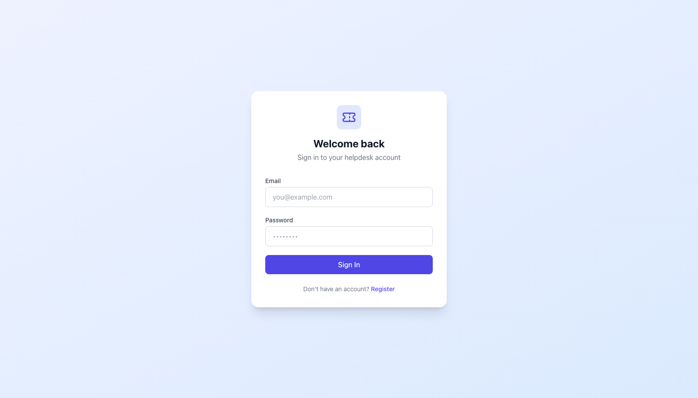
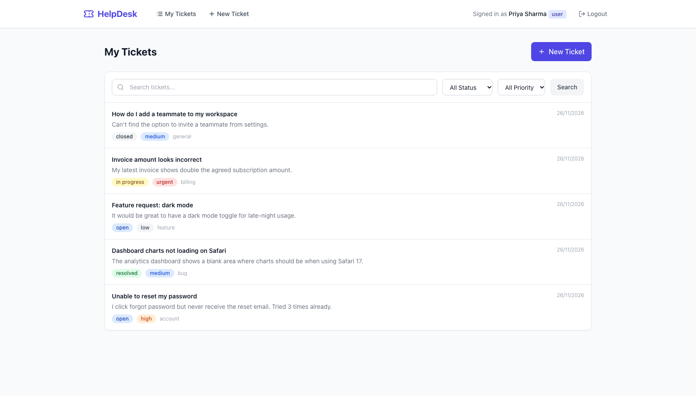
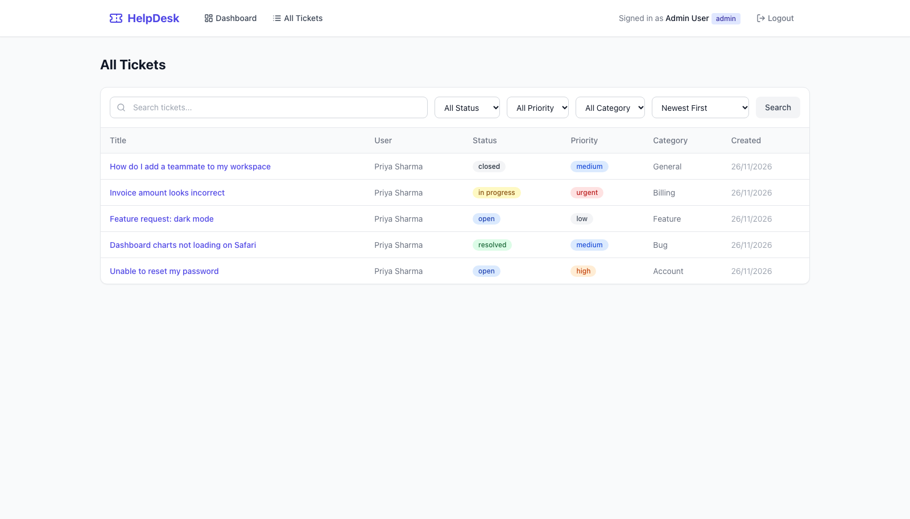
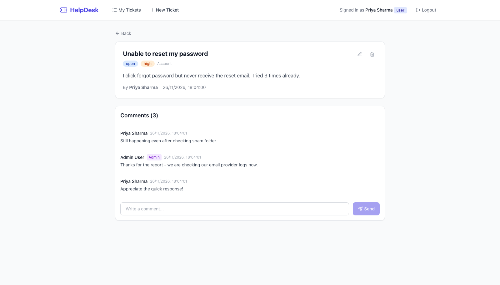

# Support Ticket Management System

A full-stack Mini Helpdesk System that lets users raise support tickets and lets administrators triage, respond to, and resolve them — built with an event-driven backend, role-based access control, and a clean React dashboard for both audiences.

**Live Demo:** [helpdesk-client-zfc1.onrender.com](https://helpdesk-client-zfc1.onrender.com) · **Tech Stack:** Node.js · Express · TypeScript · MongoDB · React · Docker

---

## Screenshots

| Login | User Dashboard |
|---|---|
|  |  |

| Admin Dashboard | Ticket Management |
|---|---|
|  |  |

<details>
<summary>Ticket detail & comment thread</summary>


</details>

---

## Features

### User
- Register and log in with secure JWT authentication
- Create, view, edit, and delete your own support tickets
- Track ticket status (Open, In Progress, Resolved, Closed)
- Add comments to tickets and see admin responses in the same thread
- Search, filter, and paginate your tickets

### Admin
- Dashboard with ticket statistics (by status, priority, category)
- View and manage tickets from all users in one place
- Update any ticket's status and priority
- Filter, sort, and search across all tickets
- Respond to any ticket with comments
- Full activity log / audit trail of every action in the system

### Event-Driven Architecture
- Activity logging via a Node.js `EventEmitter` — business logic stays decoupled from audit logging
- Events tracked: `TICKET_CREATED`, `TICKET_UPDATED`, `STATUS_CHANGED`, `TICKET_RESOLVED`, `TICKET_DELETED`, `COMMENT_ADDED`
- Full activity log, filterable by ticket or event type, accessible to admins

### Security
- Passwords hashed with bcrypt (12 salt rounds) — never stored or returned in plaintext
- JWT-based auth with role-based access control enforced server-side on every route
- Public registration always creates a `user` role — admin accounts can only be created via a server-side script, preventing privilege escalation
- Input validation (`express-validator`) on every mutation endpoint
- Ownership checks on tickets/comments — users can only access their own data, admins can access everything

---

## Tech Stack

| Layer | Technology |
|---|---|
| Backend | Node.js, Express.js, TypeScript |
| Database | MongoDB with Mongoose ODM |
| Frontend | React.js (Vite), TypeScript, Tailwind CSS |
| Authentication | JWT (JSON Web Tokens), bcrypt |
| Containerization | Docker & Docker Compose |

---

## Live Demo

| | URL |
|---|---|
| Frontend | [helpdesk-client-zfc1.onrender.com](https://helpdesk-client-zfc1.onrender.com) |
| Backend API health check | [helpdesk-server-r8jk.onrender.com/api/health](https://helpdesk-server-r8jk.onrender.com/api/health) |

**Register your own account to try it** — new accounts always start as a regular `user`, by design (see [Security](#security)). Admin accounts aren't self-serve; they're provisioned separately via the `create-admin` script described in [Setup Instructions](#creating-an-admin-account).

> **Note:** this is hosted on Render's free tier, which spins down after 15 minutes of inactivity. If the link feels slow on first load (~30–50 seconds), that's the instance waking up — not a bug. Refresh after it loads once and it'll be fast from then on.

---

## Project Structure

```
├── server/                  # Backend API
│   ├── src/
│   │   ├── config/          # Database configuration
│   │   ├── controllers/     # Route handlers
│   │   ├── events/          # Event emitter & handlers
│   │   ├── middleware/      # Auth & authorization middleware
│   │   ├── models/          # Mongoose schemas
│   │   ├── routes/          # Express routes
│   │   ├── scripts/         # One-off scripts (e.g. create-admin)
│   │   ├── utils/           # JWT token utility
│   │   └── index.ts         # Server entry point
│   ├── Dockerfile
│   └── package.json
├── client/                  # React Frontend
│   ├── src/
│   │   ├── components/      # Reusable UI components
│   │   ├── context/         # Auth context provider
│   │   ├── pages/           # Page components
│   │   ├── services/        # Axios API client
│   │   ├── types/           # TypeScript interfaces
│   │   └── App.tsx          # Router & app shell
│   ├── Dockerfile
│   └── package.json
├── screenshots/             # README screenshots
├── docker-compose.yml
└── README.md
```

---

## Setup Instructions

### Prerequisites
- Node.js 18+
- MongoDB (local or Atlas)
- npm or yarn
- Docker (optional, for one-command setup)

### Option A: Docker (recommended — one command)

```bash
git clone <repository-url>
cd support-ticket-system
docker-compose up --build
```

- Frontend: http://localhost:3000
- Backend API: http://localhost:5000/api

### Option B: Local development (without Docker)

1. **Clone the repository:**
   ```bash
   git clone <repository-url>
   cd support-ticket-system
   ```

2. **Backend:**
   ```bash
   cd server
   cp .env.example .env    # Edit .env with your MongoDB URI and JWT secret
   npm install
   npm run dev
   ```

3. **Frontend** (in a new terminal):
   ```bash
   cd client
   npm install
   npm run dev
   ```

4. **Access the app:**
   - Frontend: http://localhost:3000
   - Backend API: http://localhost:5000/api

### Creating an admin account

Admins cannot self-register through the signup form (by design — see [Security](#security)). Create one with:

```bash
cd server
npm run create-admin -- "Admin Name" admin@example.com <password>
```

Or, if running via Docker:
```bash
docker exec helpdesk-server npm run create-admin -- "Admin Name" admin@example.com <password>
```

This creates a new admin user, or promotes an existing user with that email to admin.

---

## API Documentation

### Authentication

| Method | Endpoint | Description | Auth |
|--------|----------|-------------|------|
| POST | `/api/auth/register` | Register new user | No |
| POST | `/api/auth/login` | Login | No |
| GET | `/api/auth/profile` | Get current user | Yes |

**Register Body:**
```json
{ "name": "John Doe", "email": "john@example.com", "password": "123456" }
```

**Login Body:**
```json
{ "email": "john@example.com", "password": "123456" }
```

### Tickets

| Method | Endpoint | Description | Auth | Role |
|--------|----------|-------------|------|------|
| POST | `/api/tickets` | Create ticket | Yes | User |
| GET | `/api/tickets/my` | Get my tickets | Yes | User |
| GET | `/api/tickets/all` | Get all tickets | Yes | Admin |
| GET | `/api/tickets/stats` | Get ticket stats | Yes | Admin |
| GET | `/api/tickets/:id` | Get ticket detail | Yes | Owner/Admin |
| PUT | `/api/tickets/:id` | Update ticket | Yes | Owner/Admin |
| DELETE | `/api/tickets/:id` | Delete ticket | Yes | Owner/Admin |

**Query Parameters (GET endpoints):**
- `page` - Page number (default: 1)
- `limit` - Items per page (default: 10)
- `status` - Filter by status (open, in_progress, resolved, closed)
- `priority` - Filter by priority (low, medium, high, urgent)
- `category` - Filter by category (bug, feature, general, account, billing)
- `search` - Search in title and description
- `sortBy` - Sort field (default: createdAt; whitelisted to createdAt, updatedAt, priority, status, title)
- `sortOrder` - asc or desc (default: desc)

**Create Ticket Body:**
```json
{
  "title": "Cannot login to dashboard",
  "description": "Getting 500 error when trying to access the admin panel",
  "category": "bug",
  "priority": "high"
}
```

### Comments

| Method | Endpoint | Description | Auth | Role |
|--------|----------|-------------|------|------|
| POST | `/api/comments/:ticketId` | Add comment | Yes | Owner/Admin |
| GET | `/api/comments/:ticketId` | Get comments | Yes | Owner/Admin |

### Activity Logs

| Method | Endpoint | Description | Auth | Role |
|--------|----------|-------------|------|------|
| GET | `/api/activity` | Get activity logs | Yes | Admin |

**Query Parameters:**
- `ticketId` - Filter by ticket
- `event` - Filter by event type
- `page`, `limit` - Pagination

A Postman collection can be generated from this table, or import the endpoints above directly — every route and body shape needed is documented here.

---

## Database Design

### Users Collection
| Field | Type | Description |
|-------|------|-------------|
| name | String | User's full name |
| email | String | Unique email address |
| password | String | Bcrypt hashed password |
| role | String | 'user' or 'admin' |
| createdAt | Date | Auto-generated |

### Tickets Collection
| Field | Type | Description |
|-------|------|-------------|
| title | String | Ticket title (max 200 chars) |
| description | String | Detailed description (max 5000 chars) |
| category | String | bug, feature, general, account, billing |
| priority | String | low, medium, high, urgent |
| status | String | open, in_progress, resolved, closed |
| createdBy | ObjectId | Reference to User |
| createdAt | Date | Auto-generated |
| updatedAt | Date | Auto-updated |

### Comments Collection
| Field | Type | Description |
|-------|------|-------------|
| content | String | Comment text (max 2000 chars) |
| ticket | ObjectId | Reference to Ticket |
| author | ObjectId | Reference to User |
| createdAt | Date | Auto-generated |

### Activity Logs Collection
| Field | Type | Description |
|-------|------|-------------|
| event | String | Event type (TICKET_CREATED, etc.) |
| description | String | Human-readable description |
| ticket | ObjectId | Reference to Ticket |
| performedBy | ObjectId | Reference to User |
| metadata | Mixed | Additional event data |
| createdAt | Date | Auto-generated |

**Why this shape:** Tickets and Comments reference `User` by ObjectId rather than embedding user data, so a single source of truth exists for identity (name/email changes propagate automatically via `.populate()`). Activity Logs reference the ticket loosely (no cascading delete) so the audit trail survives even after a ticket is deleted — you can see the full history of something that no longer exists. Indexes are set on `createdBy`, `status+priority`, and `ticket+createdAt` to keep the common list/filter queries fast as data grows.

---

## Implementation Decisions

1. **TypeScript** for both frontend and backend for type safety and maintainability.
2. **Event-driven architecture** using Node.js EventEmitter for decoupled activity logging.
3. **JWT stored in localStorage** with Axios interceptors for automatic token attachment and session-expiry handling.
4. **Role-based access control** via middleware — users see only their tickets, admins see all.
5. **Tailwind CSS** for rapid, consistent UI development without custom CSS overhead.
6. **MongoDB indexes** on frequently queried fields (createdBy, status+priority, ticket+createdAt) for performance.
7. **Input validation** using express-validator on all mutation endpoints.
8. **Password hashing** with bcrypt (12 salt rounds) — passwords never stored or returned in plaintext.
9. **No client-controlled roles** — registration always assigns `user`; admin provisioning is a deliberate, server-side-only action.

## Bonus Features Implemented

- Search and pagination on all list endpoints
- Sorting and multi-filter support
- Admin dashboard with ticket statistics and charts
- Activity log / audit trail
- Docker Compose for one-command deployment
- Full React frontend with responsive design

## Deployment

The simplest path needs only **two free accounts** — MongoDB Atlas (database) and Render (both backend and frontend, via one Blueprint). No credit card required for either.

### 1. Database — MongoDB Atlas (~5 min)
1. Create a free account at [mongodb.com/cloud/atlas](https://www.mongodb.com/cloud/atlas) and spin up a free **M0** cluster.
2. Under **Database Access**, create a database user (username + password).
3. Under **Network Access**, add `0.0.0.0/0` (allow access from anywhere — simplest for a demo).
4. Click **Connect → Drivers**, copy the connection string (looks like `mongodb+srv://<user>:<password>@.../`). Keep this handy for the next step.

### 2. Backend + Frontend — Render, one Blueprint (~5 min)
1. Push this repo to GitHub (if not already there).
2. Go to [render.com](https://render.com) → **New → Blueprint**, connect your GitHub account, and select this repo.
3. Render reads `render.yaml` and proposes **two services**: `helpdesk-server` (the API) and `helpdesk-client` (the React app) — click **Apply**.
4. Once `helpdesk-server` is created, open it → **Environment** → set `MONGODB_URI` to the connection string from step 1 → save (it will redeploy automatically).
5. Check the actual URL Render assigned to `helpdesk-server` (shown at the top of its dashboard page, e.g. `https://helpdesk-server-xxxx.onrender.com`). If it doesn't exactly match `https://helpdesk-server.onrender.com` (another Render user may already own that exact name), open `helpdesk-client` → **Environment** → update `VITE_API_URL` to `<that-real-URL>/api` → save and it will rebuild.
6. Visit `<backend-URL>/api/health` — should return `{"status":"ok"}`. Then open the `helpdesk-client` URL — that's your live app.

**One thing to know:** Render's free tier spins services down after 15 minutes of inactivity. The first request after idling takes ~30–50 seconds to wake up — normal, not a bug. If a recruiter is about to click the link, it's worth opening it yourself a minute beforehand.

Once live, update the [Live Demo](#live-demo) table above with the real URLs.
